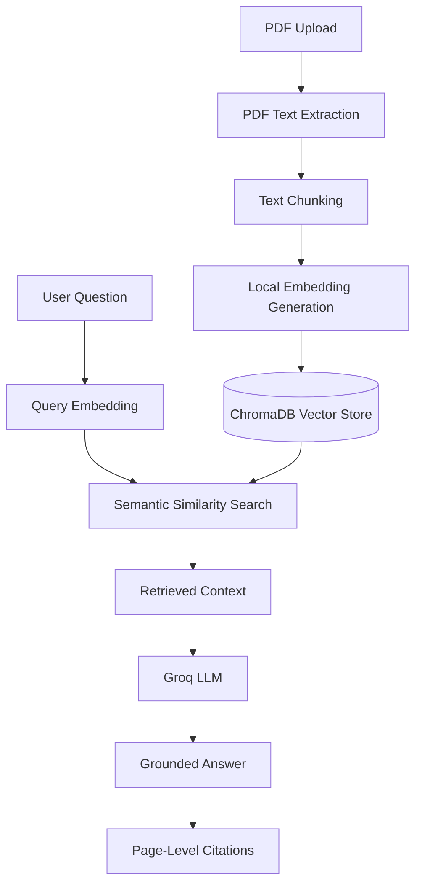

# RAG Document Intelligence

A Retrieval-Augmented Generation (RAG) application that allows users to upload PDF documents, retrieve relevant information through semantic search, and generate context-grounded answers with page-level citations.

Built with Python, FastAPI, Sentence Transformers, ChromaDB, and Groq.

## Project Overview

Large Language Models (LLMs) can generate useful answers but may lack access to information contained in private or domain-specific documents.

This project addresses that problem using Retrieval-Augmented Generation.

The application:
1. Extracts text from uploaded PDF documents.
2. Splits document text into manageable chunks while preserving page metadata.
3. Generates local text embeddings using Sentence Transformers.
4. Stores embeddings in a persistent ChromaDB vector database.
5. Retrieves relevant document passages using semantic similarity search.
6. Sends retrieved context to an LLM through the Groq API.
7. Generates answers with page-level source references.
8. Refuses to answer when the provided context does not contain the requested information.

## Architecture



## Technology Stack

| Component | Technology |
|---|---|
| Programming language | Python |
| API framework | FastAPI |
| PDF processing | PyMuPDF |
| Text embeddings | Sentence Transformers |
| Embedding model | all-MiniLM-L6-v2 |
| Vector database | ChromaDB |
| LLM provider | Groq |
| LLM model | openai/gpt-oss-20b |
| Testing | PyTest |
| Data processing | 
| API documentation | Swagger / OpenAPI |
| Version control | Git and GitHub |

## Key Features

### Document Processing
- PDF text extraction with page-number preservation.
- Configurable text chunking and overlap.
- Document identification using SHA-256 content hashing.
- Idempotent document indexing.

### Semantic Retrieval
- Local embedding generation.
- Persistent vector storage with ChromaDB.
- Cosine similarity search.
- Optional document-specific retrieval filtering.
- Similarity scores for retrieved passages.

### Grounded Answer Generation
- LLM integration through Groq.
- Context-based answer generation.
- Page-level source references.
- Instructions to abstain when the context does not contain an answer.

### REST API
- PDF document upload.
- Question-answering endpoint.
- Health-check endpoint.
- Interactive Swagger documentation.

### Evaluation and Testing
- Automated unit and API tests.
- Retrieval evaluation using Hit@K and Precision@K.
- Answerability evaluation.
- Keyword-based answer relevance evaluation.
- Page citation evaluation.
- Unanswerable-question abstention evaluation.

## Project Structure

```text
rag-document-intelligence/
│
├── app/
│   ├── api/
│   │   └── main.py
│   ├── ingestion/
│   │   ├── pdf_loader.py
│   │   ├── chunker.py
│   │   └── indexer.py
│   ├── retrieval/
│   │   ├── embeddings.py
│   │   ├── vector_store.py
│   │   └── retriever.py
│   ├── llm/
│   │   ├── base.py
│   │   ├── groq_provider.py
│   │   └── answer_generator.py
│   └── rag_pipeline.py
│
├── evaluation/
│   ├── questions.json
│   ├── evaluate_retrieval.py
│   └── evaluate_answers.py
│
├── tests/
├── data/
├── .env.example
├── .gitignore
├── create_sample_pdf.py
├── run_rag.py
└── README.md
```

## Getting Started

### Prerequisites

- Python 3.13
- Git
- A free Groq API account and API key

### 1. Clone the repository

```bash
git clone https://github.com/YOUR_USERNAME/rag-document-intelligence.git
cd rag-document-intelligence
```

### 2. Create a virtual environment

Windows:

```powershell
python -m venv .venv
.venv\Scripts\Activate.ps1
```

### 3. Install dependencies

```powershell
pip install -r requirements.txt
```

### 4. Configure environment variables

Create a `.env` file in the project root using `.env.example` as a template.

```env
GROQ_API_KEY=your_groq_api_key
GROQ_MODEL=openai/gpt-oss-20b
```

Never commit your `.env` file or expose your API key publicly.

### 5. Generate the sample PDF

```powershell
python create_sample_pdf.py
```

### 6. Run the RAG application

```powershell
python run_rag.py
```

### 7. Run the API

```powershell
python -m uvicorn app.api.main:app --reload
```

Open the interactive API documentation:

http://127.0.0.1:8000/docs

## API Endpoints

| Method | Endpoint | Description |
|---|---|---|
| GET | `/health` | Check application health |
| POST | `/documents/upload` | Upload and index a PDF |
| POST | `/questions/ask` | Ask a question about indexed documents |

### Example workflow

1. Start the FastAPI server.
2. Open Swagger documentation.
3. Upload a PDF through `/documents/upload`.
4. Submit a question through `/questions/ask`.
5. Inspect the generated answer and source references.

## Evaluation Results

The project includes a small evaluation dataset containing eight questions based on a two-page sample PDF.

### Answer Evaluation

| Metric | Result |
|---|---:|
| Answerability accuracy | 100% |
| Answer relevance (keyword match) | 80% |
| Citation correctness | 100% |
| Unanswerable question abstention | 100% |

### Retrieval Evaluation

The initial five-question retrieval evaluation achieved:

| Metric | Result |
|---|---:|
| Hit@1 | 100% |
| Hit@3 | 100% |
| Hit@5 | 100% |
| Precision@1 | 100% |
| Precision@3 | 50% |
| Precision@5 | 50% |

**Evaluation limitations:** These results are based on a small synthetic sample document and a limited question set. Answer relevance uses keyword matching rather than semantic evaluation. Citation correctness checks expected page references against retrieved source metadata. These results should be treated as an initial baseline, not evidence of general-purpose RAG accuracy.

## Testing

Run the automated test suite:

```powershell
python -m pytest -v
```

Latest verified test result: **55 tests passed**.

## Design Decisions

- **Local embeddings:** Sentence Transformers generates embeddings locally without requiring a paid embedding API.
- **Persistent vector storage:** ChromaDB stores embeddings between application runs.
- **Provider abstraction:** The LLM interface separates answer generation from the specific provider implementation.
- **Document identification:** SHA-256 hashing supports consistent document IDs and repeat indexing.
- **Source traceability:** Page metadata is preserved through ingestion and retrieval.
- **Dependency injection:** Components can be tested using fake providers and test doubles without making real LLM API calls.

## Limitations

- PDF text extraction does not currently provide OCR for scanned documents.
- Retrieval quality depends on chunking, embedding quality, and document content.
- Generated answers may still contain inaccuracies despite context-grounding instructions.
- Citation validation is based on page references and does not independently verify every factual claim.
- Evaluation currently uses a small dataset and rule-based metrics.
- The application depends on Groq API availability and applicable free-tier limits.

## Future Improvements

- Add OCR support for scanned PDFs.
- Improve retrieval using hybrid search and reranking.
- Introduce configurable similarity thresholds.
- Expand evaluation datasets with more documents and questions.
- Improve citation verification at the sentence level.
- Add a Streamlit user interface.
- Add structured logging and performance monitoring.

## Security

- API credentials are loaded from environment variables.
- `.env` is excluded from version control.
- Uploaded documents are stored locally.
- API deployment should include authentication, rate limiting, and additional upload security controls.

## License

This project is intended as an educational and portfolio project. A formal open-source license can be added before public distribution.